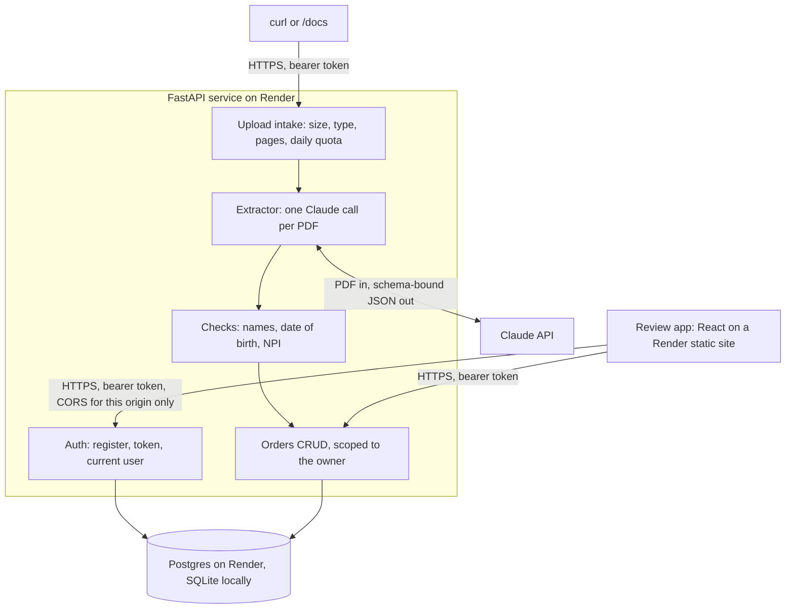

# DME order intake

A REST API that reads faxed DME order PDFs and turns them into checked orders. It extracts the patient's first name, last name and date of birth, and the ordering provider's name and NPI. Each user sees only their own orders. A small React app sits on top for reviewing orders.

## 1. Where it runs

| What | URL |
|---|---|
| Review app | https://dme-order-intake-ui.onrender.com |
| API docs (Swagger) | https://dme-order-intake.onrender.com/docs |

The API runs on Render's free plan. **After 15 idle minutes the first request takes about a minute** while the instance wakes up; after that, requests are fast and an upload takes about 5 to 10 seconds.

This deployment is for synthetic data only (see [section 6](#6-security-and-privacy)).

## 2. Try it in one minute

**In the browser:** open the review app, enter any email and a password of 8 or more characters, and click **Sign up**. Drop an order PDF on the upload box. When it's read, the order opens with one row per field: the value saved on the order, what was read from the document, the check result and reason, the page and the quote. Click **Fix** next to a field to correct it, and **Delete order** to remove it.

Swagger works too: register with `POST /auth/register`, then click **Authorize** and log in with the same email and password.

**With curl:**

```bash
API=https://dme-order-intake.onrender.com
curl -s -X POST "$API/auth/register" -H "Content-Type: application/json" \
  -d '{"email": "tester@example.com", "password": "choose-a-password"}'
TOKEN=$(curl -s -X POST "$API/auth/token" -d "username=tester@example.com" -d "password=choose-a-password" \
  | python3 -c 'import json, sys; print(json.load(sys.stdin)["access_token"])')

# Upload a PDF; the response is the new order
curl -s -X POST "$API/orders/upload" -H "Authorization: Bearer $TOKEN" \
  -F "file=@order.pdf;type=application/pdf" | tee order.json | python3 -m json.tool
ID=$(python3 -c 'import json; print(json.load(open("order.json"))["id"])')

# Read it, list all your orders, fix a field, delete it
curl -s "$API/orders/$ID" -H "Authorization: Bearer $TOKEN" | python3 -m json.tool
curl -s "$API/orders?status=needs_review" -H "Authorization: Bearer $TOKEN" | python3 -m json.tool
curl -s -X PATCH "$API/orders/$ID" -H "Authorization: Bearer $TOKEN" -H "Content-Type: application/json" \
  -d '{"provider_npi": "1234567893"}' | python3 -m json.tool
curl -s -o /dev/null -w "%{http_code}\n" -X DELETE "$API/orders/$ID" -H "Authorization: Bearer $TOKEN"
```

`1234567893` is the example NPI from the CMS documentation; it passes the NPI check. Orders can also be created by hand with `POST /orders`, with dates as `YYYY-MM-DD`.

## 3. What happens to each field

**Each field comes back twice.** The top-level fields (`patient_first_name`, `patient_last_name`, `patient_dob`, `provider_name`, `provider_npi`) hold only values that passed every check. `field_report` holds, for each field, what the document actually said: `value_as_read`, a `status`, a `reason`, and the `page` and `quote` it came from. A value that fails a check is never stored on the order, because a wrong value means a denied claim. The order's `status` is `complete` only when all five fields passed; otherwise it is `needs_review`.

**The NPI printed on the sample order is not a valid NPI.** It starts with 9, while real NPIs start with 1 or 2, and it also fails the NPI check digit. So the sample comes back `needs_review` with `provider_npi` empty, and the reading is in `field_report`:

```json
"status": "needs_review",
"provider_npi": null,
"field_report": {
  "provider_npi": {
    "status": "invalid",
    "value_as_read": "9182734556",
    "reason": "NPI must start with 1 or 2",
    "page": 1,
    "quote": "Prescriber NPI: 9182734556"
  }
}
```

**Anyone testing with made-up NPIs will see this.** If `provider_npi` is null, look at `field_report.provider_npi` for the value that was read and why it was refused. The other four fields on the sample pass. The model picks the prescriber on page 1 as the ordering provider and leaves the referring physician named on page 2 alone. A reviewer can correct a field with `PATCH`; its report entry then says `set by hand` and keeps the value as read.

## 4. The checks

| Field | Check |
|---|---|
| Patient first and last name | Letters in any alphabet, spaces, hyphens, apostrophes (straight or curly, as scans produce), periods and commas. Not a placeholder like "unknown". At most 100 characters. |
| Provider name | The same rules, at most 200 characters. The model leaves out credentials such as MD or DPM. |
| Date of birth | Read as printed. Numeric dates are US month/day/year. A two-digit year is refused instead of guessing the century. It must be a real date, not in the future and not more than 130 years ago. |
| NPI | 10 digits once spaces and hyphens are removed, starting with 1 or 2, with a valid check digit (Luhn with the 80840 prefix). |

| Field status | Meaning | Stored on the order |
|---|---|---|
| `ok` | Found and passed every check | The value |
| `missing` | Not in the document, or the model could not read it reliably | Nothing |
| `invalid` | Read, but failed a check; `reason` says which | Nothing |
| `conflict` | The document gives different values, for example two dates of birth on two pages; `quote` shows both | Nothing |

The model is told to return null rather than infer: no date of birth worked out from an age, no NPI borrowed from another provider. A document where no field is found at all is rejected with a 422 and nothing is saved.

## 5. How it is built



Python 3.13, FastAPI, SQLAlchemy with Alembic migrations that run on start, pydantic, and the Anthropic SDK with `claude-opus-5-5` and structured output. pypdf checks uploads. Passwords use argon2 and tokens are JWTs. The frontend is React and TypeScript built with Vite. CI runs ruff and pytest for the API, and ESLint, typecheck, Vitest and the build for the frontend.

```
app/             FastAPI service
  routers/       HTTP routes: auth, orders
  services/      logic: auth, orders, intake (the upload flow)
  extractor.py   the one Claude call, faked in tests
  checks.py      name, date of birth and NPI rules
migrations/      Alembic, run when the app starts
frontend/        React review app, its own Render static site
scripts/         fake_faxes.py
tests/           pytest, no network
docs/design.md   the plan, and the decisions with their reasons
AGENTS.md        rules for coding agents (CLAUDE.md imports it)
```

## 6. Security and privacy

What the service does today:

- **Uploads are never stored.** A PDF is read in memory, sent to Claude and dropped; only its SHA-256 and page count are kept. Starlette's spill-to-disk limit is raised so an upload never reaches a temp file. Uploads over 10 MB are cut off while the body is still arriving.
- **No patient data in logs or errors.** Logs hold ids, statuses and timings only, and a test checks that no field value, quote or filename gets logged. Validation errors never echo the input back, database errors hide the values bound to the query, and the PDF library's warnings are switched off because they quote raw bytes from damaged files.
- **Each user's orders are private.** Every query filters by owner, and another user's order returns 404, the same as one that doesn't exist. The tests cover read, update, delete and list with two users.
- **Accounts and tokens:** argon2 password hashes and JWTs that expire after 60 minutes. A login with an unknown email takes as long as one with a wrong password.
- **Limits:** a length cap on every string field, a page-size cap on the list, and 100 uploads per user per 24 hours.
- **Frontend:** the token stays in memory only. Nothing goes in browser storage or the console, and the API allows only the app's origin through CORS.
- **Secrets and database:** secrets are only in environment variables. The database accepts no connections from the internet, only from the web service.

**Synthetic data only.** Uploads go to the Claude API and data sits on Render, and there is no BAA with either. Real PHI would need, at least:

- BAAs with the model provider and the host, on plans that are HIPAA-eligible
- encryption of field values at rest
- an audit log of who viewed or changed each order
- MFA or SSO, and organisation-level access instead of one user per order
- a retention and deletion policy
- backups, monitoring and access reviews

## 7. What I left out, and what I'd do next

- **Accuracy is only spot-checked**, on the sample and three generated faxes. Next: a labelled set of real-looking faxes with per-field accuracy, run on every prompt or model change.
- **No NPI registry lookup.** Next: check the NPI against NPPES and confirm it belongs to the named provider.
- **Uploads are synchronous.** That's fine at 5 to 10 seconds per PDF; at volume it needs a queue with status polling.
- **The PDF is not kept**, so a reviewer can't compare against the source in the app. A retention-limited, encrypted store would fix that.
- **The quota only counts saved orders.** A rejected upload that reached the model costs money without counting; the spend limit on the API key is the real cost cap.
- **No refresh tokens, password reset, roles or organisations.** The free Postgres expires 30 days after creation, so it needs a paid plan before then.
- **Smaller gaps:**
  - The NPI reason names only the first rule that fails.
  - Dates are assumed to be US month/day.
  - The frontend has no component tests, and its TSDoc rule isn't lint-enforced.

## 8. Running it locally

```bash
python -m venv .venv
.venv\Scripts\activate          # macOS/Linux: source .venv/bin/activate
pip install -r requirements-dev.txt
cp .env.example .env            # fill in JWT_SECRET (32+ characters) and ANTHROPIC_API_KEY
uvicorn app.main:app --reload   # http://127.0.0.1:8000/docs
pytest                          # 121 tests, no network: the model call is faked
ruff check . && ruff format --check .
```

Frontend, from `frontend/`: `npm ci`, then `npm run dev` (http://localhost:5173, uses the API on port 8000) and `npm test` (13 tests). Exact commands for every task are in [AGENTS.md](AGENTS.md).

**Fake faxes:** `python -m scripts.fake_faxes` draws three made-up orders as image-only PDFs, with skew and speckle like a fax. It then runs them through the real extractor, which makes three paid model calls. Every person and number in them is made up. The last run gave:

| Fax | What it tests | Result |
|---|---|---|
| `no_npi` | A cover sheet plus an order with no NPI anywhere | `provider_npi` is `missing`, "not found in the document"; the other four fields are `ok` |
| `two_digit_year` | Date of birth printed as `03/14/62` | `patient_dob` is `invalid`, "two-digit year is ambiguous"; the value as read is kept |
| `conflicting_dob` | The order and a progress note give different dates of birth | `patient_dob` is `conflict`, and the quote shows both readings with their pages |

## 9. How this was built

This was built with a coding agent (Claude Code) in one session. [AGENTS.md](AGENTS.md) holds the rules the agent follows: code style, commands and the security rules. [CLAUDE.md](CLAUDE.md) only imports it.

The work started with a plan, [docs/design.md](docs/design.md), covering requirements, assumptions, architecture and build order, which was reviewed before any code. After that the agent worked in small steps. Each step had its own tests, a commit and a push, followed by a check against the live deploy. The agent session export comes with the submission email; it's not in the repo, because it includes the sample order's contents.
